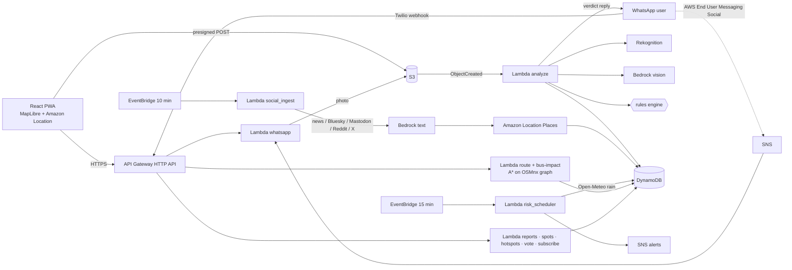

# 🌊 Can My Scooter Cross?

**Photo, WhatsApp, social posts and live rain → water depth → a verdict for *your* vehicle → a route around flooded roads *and* lanes.**
Environmental Hacks 2026 (WeMakeDevs × AWS) · Track 02: Heat and Water · Regions: **Delhi, Gurugram, Kochi** (+ Mumbai).

At the edge of a waterlogged road, people ask one question: *"Can MY vehicle cross this?"* Navigation apps don't know the depth, and know nothing about inner lanes (galis). Scooters are the most common vehicle in Indian cities and the most likely to stall.

**➡️ Deploying or picking this up? Start with [DEPLOY.md](DEPLOY.md).** What is live on AWS right now: [DEPLOYMENT_STATUS.md](DEPLOYMENT_STATUS.md).

## What it does
| | |
|---|---|
| 📷 **Photo → verdict** | Amazon Bedrock (Claude vision) estimates depth from kerbs, tyres and legs. A deterministic, unit-tested rules engine (not the AI) gives GO / RISKY / NO-GO for walking, cycle, petrol scooter, EV scooter, auto, car, SUV, bus and ambulance. |
| 💬 **WhatsApp reporting** | Send a photo + location to the WhatsApp number and get the verdict back on WhatsApp, no app needed. Send a location for nearby flooded spots, or a place name ("Minto Bridge") for its status. Twilio sandbox, or AWS End User Messaging Social. |
| 🇮🇳 **Where is it raining in India now** | Tap the rain pill: live rainfall at ~50 cities (Open-Meteo), dots on a map of India, honest headline ("no heavy rain right now" on a calm day), and recent news and social posts for any city you tap. Fully supported live cities: Delhi, Gurugram, Kochi, Thiruvananthapuram, Mumbai. |
| 🌧 **Real-time rain** | Every 15 min, live rainfall at every chronic hotspot (Open-Meteo). Heavy rain turns a hotspot into a **predicted** spot (low confidence, so verdicts are stricter) until a real report confirms or replaces it, and sends SNS alerts. |
| 📰 **Social media + news** | Every 10 min, Google News, Bluesky and Mastodon (no keys), plus Reddit, X and YouTube if keys are set. Bedrock extracts place, depth words and closures. Amazon Location geocodes. Official closures = NO-GO for all. |
| ✅ **Ground truth** | Chronic hotspots for Delhi, Gurugram and Kochi, each **cited to a news report** and **position-checked against OpenStreetMap** (`data/hotspots_*.geojson`). Every spot shows its level: 🌧 predicted → 📷 AI estimate → ✔ confirmed by several reports → 🛡 official. |
| 🕳️ **DrainReady** | Residents photograph a blocked drain. Bedrock classifies it as clear / partly / fully blocked. Duplicates within 30 m are grouped. Blockages are ranked by severity × number of reporters × 24 h rain forecast × nearness to a known flood spot. A dispatcher assigns a worker, and a drain is only marked cleared when the **after-photo itself shows a clear drain**. Impact: cleared before rain, median hours to clear, repeat blockages. **Reliable by design:** if Bedrock is unavailable the report is kept and rated from basic image labels, clearly labelled "AI analysis unavailable / needs review"; a drain is never auto-cleared without verification (a dispatcher confirms manually, recorded as such); stuck analyses show an error with a Retry button instead of failing silently. |
| 🗺️ **Map** | Amazon Location (or OpenStreetMap) by default; set `VITE_GOOGLE_MAPS_API_KEY` to use the Google Maps basemap with the same pins and routes, falling back automatically if Google is unavailable. |
| 👤 **Sign in + saved places** | Amazon Cognito email sign-in (confirmation code, forgot password). Save Home, Work and other addresses and use them in one tap when planning a route. API Gateway verifies the Cognito token itself, and every place is keyed by the signed-in user. |
| 🧭 **Safe route + "who can still go?"** | One trip, six vehicle profiles, including separate petrol and EV scooters. *"Scooter must detour (+2 min), car can take the usual road slowly, bus OK."* Tap a vehicle to see its route. Lanes included; buses stay on bus-capable roads. |
| 🚌 **Buses** | Bus routes passing a flooded spot (likely diverted), and stops that are unsafe to walk to. From the official GTFS (Delhi DTC/cluster) or OSM. |

## Architecture

**AWS:** Amplify, API Gateway, Lambda, Bedrock (vision + text), Rekognition, S3, DynamoDB (TTL + Streams), SNS, EventBridge Scheduler, Amazon Location Service (maps + Places geocoding), AWS End User Messaging Social (WhatsApp), SSM Parameter Store, CloudWatch (EMF metrics) and X-Ray. **AWS open source:** SAM / SAM CLI.

## Ground truth and honesty
- **We don't claim centimetre accuracy.** Reliable metric depth from one photo or a phone video is hard (perspective, reflections, unknown road shape). So the UI leads with **categories**: *Passable · Potentially unsafe · Unsafe · Requires inspection*, and the depth is shown as a rough band rounded to 5 cm. If confidence is low, the image is poor, no reference object (kerb, tyre, person) is visible, or the range is very wide, the app says **Requires inspection** and a "GO" is never shown as passable (it is also escalated). Videos are reduced to one still frame and use the same pipeline.
- **Hotspots** (`data/hotspots_<city>.geojson`): `source_url` is a news report naming the spot. `osm_match` says how the position was checked: an OSM `tunnel=yes` underpass, a named junction, or a road × railway intersection (Minto Bridge = Vivekanand Marg under the railway). Points without a citation are `verified: false` and are not seeded.
- **Rain** is Open-Meteo model data (analysis + nowcast), not a rain gauge. The UI labels it.
- **Predicted spots** are clearly labelled 🌧 and use low confidence, so the rules engine is stricter. A real report within 150 m replaces the prediction.
- **Social posts**: only public posts via official APIs/feeds. Handles are shown only for official accounts, and every pin links to its source.
- **Depth accuracy**: `cd backend && python -m tests.eval_depth` on `data/eval_set.csv` gives MAE, % within ±10 cm, and **"scooter told GO when truth NO-GO"** (the dangerous error).

## Rules (`backend/common/config.py`)
| Vehicle | GO if < | RISKY | NO-GO if ≥ |
|---|---|---|---|
| Pedestrian | 10 | 10–30 | 30 |
| Bicycle / Petrol scooter | 10 | 10–20 | 20 |
| EV Scooter | 12 | 12–16 | 16 |
| Auto | 15 | 15–25 | 25 |
| Car | 15 | 15–30 | 30 |
| SUV | 25 | 25–45 | 45 |
| Bus / truck | 40 | 40–60 | 60 |
| Ambulance | 20 | 20–35 | 35 |

Each of these worsens every verdict by one level: low confidence or poor photo · flowing water · strong current / open drain / wire in water. A wire in the water means NO-GO for everyone. Rain thresholds: ≥20 mm in 3 h or ≥7.5 mm/h → "flooding likely now". ≥15 mm forecast in the next 3 h → warning.

The EV Scooter depths are configurable app-level caution thresholds, not ground-clearance or water-ingress specifications for every model. They do not predict battery damage, and a depth below the caution threshold is not a safety guarantee. Photo-based depth estimates are uncertain; avoid crossing if unsure.

## Routing data
| City | Area | Nodes | Edges (galis) | Size |
|---|---|---|---|---|
| Delhi | Minto Bridge · ITO · Pragati Maidan · Moolchand | 19.5k | 21.3k (10.5k) | 0.6 MB |
| Gurugram | Hero Honda · Rajiv Chowk · IFFCO · Golf Course Rd | 28.1k | 29.6k (23.3k) | 0.7 MB |
| Kochi | MG Road · Jos/Woodlands · KSRTC · Kaloor · Edappally | 11.7k | 13.1k (9.8k) | 0.4 MB |

OSMnx `all` network, minus private gated-society roads, parking aisles and driveways. Buses use only motorway/trunk/primary/secondary/tertiary roads. Start and end points snap to the strongly connected part of each vehicle's network, so a route never starts on a one-way stub.

## Run it
### Local, no AWS
```bash
python3 -m venv .venv && .venv/bin/pip install -r scripts/requirements.txt
.venv/bin/python scripts/local_api.py --social           # live rain + live social feeds
cd frontend && npm install && cp .env.example .env.local  # set VITE_API_URL=http://localhost:8787
npm run dev
.venv/bin/python scripts/seed_social.py --city delhi --dry-run --no-llm --hours 48   # what's being posted now
cd backend && ../.venv/bin/python -m pytest -q           # 67 tests
```
### Deploy
```bash
sam build && sam deploy --guided       # region ap-south-1; set AppUrl, optionally RedditClientId/Secret, YouTubeApiKey, XBearerToken
for c in delhi gurugram kochi thiruvananthapuram; do
  python scripts/build_graph.py --city $c --bucket <PhotosBucketName>
  python scripts/seed_hotspots.py --city $c --table <HotspotsTableName>
done
python scripts/import_gtfs.py --city delhi --gtfs delhi-bus.zip --bucket <PhotosBucketName>   # Delhi buses
```
### WhatsApp
**Twilio sandbox (fastest, about 10 min):** Twilio console → Messaging → *Try WhatsApp*. Set "When a message comes in" to the `WhatsAppTwilioWebhook` stack output (POST). Then store the credentials:
```bash
aws ssm put-parameter --name /scooter-cross/whatsapp/twilio_account_sid --type SecureString --value ACxxxx
aws ssm put-parameter --name /scooter-cross/whatsapp/twilio_auth_token --type SecureString --value xxxx
aws ssm put-parameter --name /scooter-cross/whatsapp/twilio_from --type String --value whatsapp:+14155238886
```
Set `VITE_WHATSAPP_NUMBER=14155238886` and `VITE_WHATSAPP_JOIN="join <your-sandbox-code>"` in Amplify.

**AWS End User Messaging Social (AWS-native):** link a WhatsApp Business Account in the console, pick an SNS topic for events, and deploy with `WhatsAppTopicArn=<that topic>`.

## Demo mode

The **Demo** switch (top bar) shows a made-up heavy-rain evening in central Delhi (Minto Bridge, ITO, Pragati Maidan, Moolchand, Ashram) with a time slider, so the app can be shown on a dry day.
The values are invented (`backend/common/simulation.py`) and every pin, post and figure carries a DEMO tag.
The logic is real: verdicts come from the same rules, spots are merged by the same code, and routes are planned by the same router. Nothing from the demo is written to the database or can trigger an alert.
Endpoint: `GET /simulation?at=<epoch>`; routes: `POST /route` with `"mode": "sim"`.

## Limitations
- Depth from one photo is an estimate. We always show the range, confidence, evidence and a disclaimer ("If unsure, don't cross. Emergency: 112").
- The app shows only live data. Delhi and Gurugram are dry in October, so live pins there appear only when it rains and people report. Southern Kerala is the wettest region during the north-east monsoon, and the India rain view shows where it is raining at any moment.
- Gurugram and Kochi have no open bus GTFS. OSM bus relations are used if present.
- The X API is paid, so it's off unless a token is provided. Reddit needs free OAuth app credentials.

## Credits
Map data © OpenStreetMap contributors (ODbL). Rain: Open-Meteo (CC BY 4.0). Delhi bus GTFS: Delhi Transport Dept / OTD. Hotspot sources: The Week/PTI, Tribune, ETV Bharat, LG Delhi, Kerala Kaumudi, The News Minute, Onmanorama (links in the geojson files).
